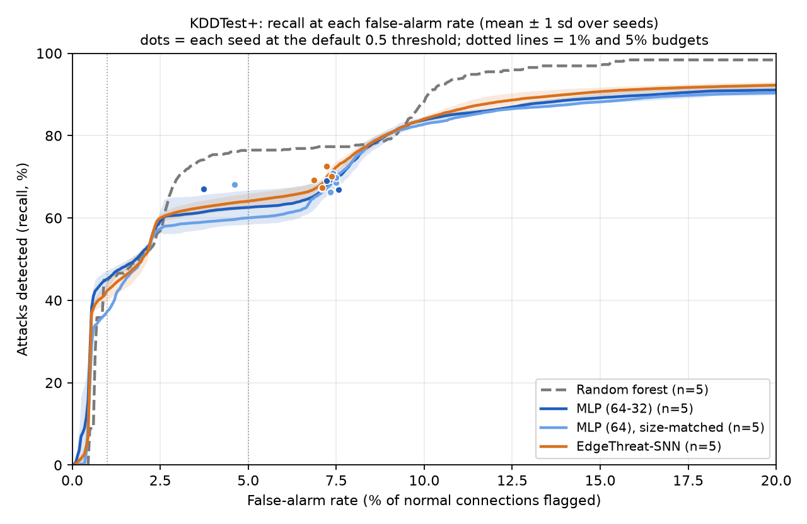
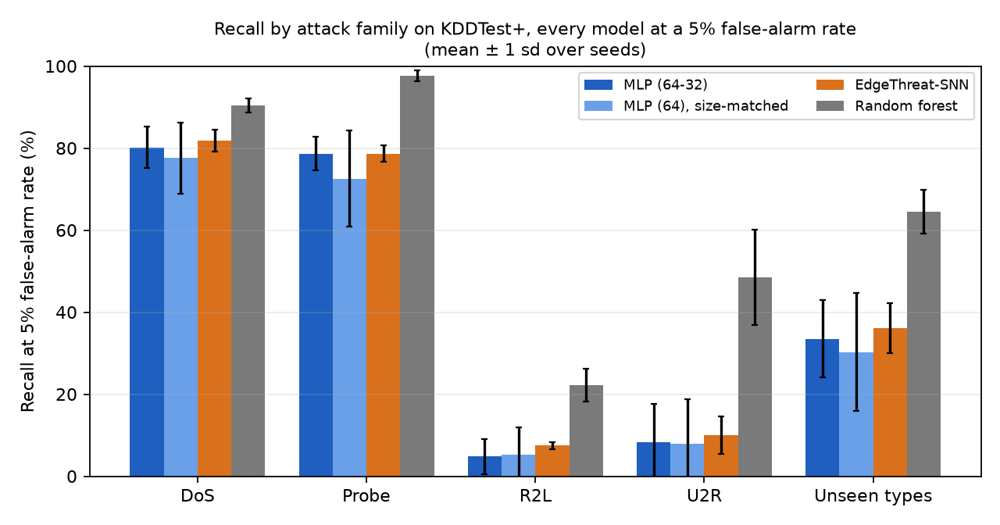
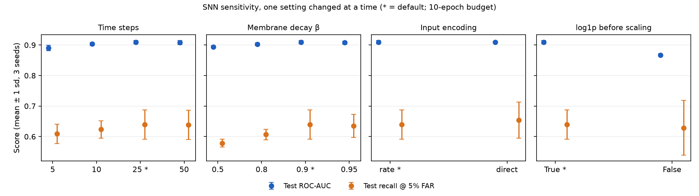

# EdgeThreat-SNN

A controlled comparison of a spiking neural network (SNN) with conventional classifiers for binary network-intrusion detection on NSL-KDD. Every model gets the same data, preprocessing, training budget and five seeds. The models are compared at fixed false-alarm rates, on attack types never seen in training, and on the cost of each prediction.

## Key findings

- **The SNN matches the MLPs but doesn't beat them.** ROC-AUC is 0.907 ± 0.004 for the SNN, 0.904 ± 0.008 for a 64-32 MLP, and 0.897 ± 0.008 for an MLP with exactly the SNN's 8,002 parameters. At a 5% false-alarm rate the SNN catches 64.1% of attacks, against 62.6% and 60.0%. No SNN–MLP difference is significant (Welch's t-test over 5 seeds; the smallest p is 0.054, against a corrected threshold of 0.004 for 12 comparisons).
- **A random forest is the best detector.** It reaches ROC-AUC 0.959 and catches 76.5% of attacks at a 5% false-alarm rate (both p < 0.001 against the SNN). At that same rate it also catches 64% of attacks of types never seen in training, against 30–36% for the neural models.
- **Feature scaling matters more than the neuron type.** In the sensitivity analysis, removing `log1p` from the heavy-tailed features lowers the SNN's ROC-AUC from 0.910 to 0.867, a far larger gap than any SNN–MLP difference.
- **On a CPU the SNN is about 200× slower per prediction:** 7.1 ms against 35 µs on one thread of an AMD Ryzen 7 7435HS. An operation count estimates 23.1 nJ per prediction on event-driven hardware, against 36.5–45.6 nJ for the MLPs; that is an estimate, not a measurement. The hidden layer fires on 14.5% of time steps, so the network is not especially sparse.
- **KDDTest+ is shifted away from the training data.** A threshold set for 1% false alarms on validation data flags about 8% of normal test traffic.



## What is compared

| Model | Description | Trainable parameters |
| --- | --- | ---: |
| EdgeThreat-SNN | 122 inputs → 64 leaky integrate-and-fire neurons → 2 leaky integrators, 25 time steps, rate-coded input (snnTorch) | 8,002 |
| MLP (64-32) | 122 → 64 → 32 → 2, ReLU | 10,018 |
| MLP (64), size-matched | 122 → 64 → 2, ReLU. Same layer sizes and parameter count as the SNN; only the neuron model and the spike input differ | 8,002 |
| Logistic regression | scikit-learn, `max_iter=2000` | 123 |
| Random forest | scikit-learn, 100 trees | – |

## Method

**Data.** NSL-KDD (Tavallaee et al., 2009): 125,973 training and 22,544 test connections with 41 features each, downloaded and checksum-verified by `scripts/download_data.py` (see [data/README.md](data/README.md)). 15% of KDDTrain+ (stratified, fixed seed) is held out for validation, leaving 107,077 training and 18,896 validation rows. KDDTest+ is used only for the final evaluation. It is a shifted test set: 56.9% of it is attacks, against 46.5% in training, and 3,750 of its 12,833 attacks belong to 17 attack types that never occur in training.

**Preprocessing** (`src/data.py`). The 17 numeric features whose training maximum is above 1 (bytes, durations, counts) are `log1p`-transformed. All 38 numeric features are then min-max scaled to [0, 1], fitted on the training split only and clipped. The 3 categorical features are one-hot encoded (3 + 70 + 11 columns), giving 122 inputs. Without `log1p`, heavy-tailed features almost never produce spikes under rate coding: 99.8% of `src_bytes` values scale below 0.001.

**SNN** (`src/models.py`). Each scaled feature is a Bernoulli spike probability at each of 25 time steps. Hidden neurons have membrane decay β = 0.9 and threshold 1.0, and reset by subtraction. Training uses snnTorch's fast-sigmoid surrogate gradient (slope 25) with backpropagation through time. The two output neurons integrate without spiking; their membrane potential, averaged over time, is the logit. Test scores are averaged over 5 independent spike encodings.

**Training** (`src/train.py`). Every neural model uses Adam (learning rate 1e-3), mini-batches of 256, at most 50 epochs, and early stopping when validation loss has not improved for 3 epochs. The SNN draws new spikes for every mini-batch. Each model is trained with 5 seeds; logistic regression is trained once, since it is deterministic. Every model stopped on its own, at best epochs of 13–20 (SNN), 11–21 (MLP 64-32) and 31–38 (size-matched MLP). Nothing was tuned on KDDTest+. One caveat: `log1p` was adopted after preliminary test results had been seen, so that choice is not fully independent of the test set. The sensitivity analysis below shows its effect.

**Evaluation** (`src/evaluate.py`, the only source of the numbers below). Scores are log-odds, because float32 probabilities saturate at 1.0 and create ties. Reported:

- metrics at the default threshold (probability 0.5), including the false-alarm rate (FAR = false positives / all normal connections);
- ROC-AUC, PR-AUC, and the best recall reachable at FAR ≤ 1% and ≤ 5%, the main comparison;
- the test recall and FAR of a threshold set on validation data alone (1% FAR on validation);
- recall per attack family and on attack types unseen in training, with every model at the same 5% FAR.

Mean ± standard deviation is over seeds. Significance is Welch's t-test across seeds (`scripts/significance.py`).

## Results

KDDTest+, 22,544 connections. Threshold metrics use probability 0.5. Source: `results/tables/summary.md`.

| Model | Seeds | Accuracy | Precision | Recall | F1 | FAR | ROC-AUC | PR-AUC | Recall @ 1% FAR | Recall @ 5% FAR |
| --- | ---: | ---: | ---: | ---: | ---: | ---: | ---: | ---: | ---: | ---: |
| MLP (64-32) | 5 | 0.790 ± 0.007 | 0.931 ± 0.016 | 0.681 ± 0.011 | 0.787 ± 0.007 | 0.067 ± 0.016 | 0.904 ± 0.008 | 0.929 ± 0.008 | 0.452 ± 0.023 | 0.626 ± 0.046 |
| MLP (64), size-matched | 5 | 0.793 ± 0.010 | 0.930 ± 0.012 | 0.688 ± 0.017 | 0.790 ± 0.012 | 0.069 ± 0.013 | 0.897 ± 0.008 | 0.920 ± 0.008 | 0.374 ± 0.087 | 0.600 ± 0.086 |
| EdgeThreat-SNN | 5 | 0.794 ± 0.012 | 0.928 ± 0.002 | 0.693 ± 0.022 | 0.793 ± 0.015 | 0.071 ± 0.002 | 0.907 ± 0.004 | 0.929 ± 0.004 | 0.424 ± 0.028 | 0.641 ± 0.020 |
| Logistic regression | 1 | 0.743 | 0.912 | 0.607 | 0.729 | 0.077 | 0.776 | 0.861 | 0.313 | 0.380 |
| Random forest | 5 | 0.776 ± 0.011 | 0.969 ± 0.001 | 0.627 ± 0.020 | 0.761 ± 0.015 | 0.027 ± 0.000 | 0.959 ± 0.002 | 0.961 ± 0.002 | 0.449 ± 0.015 | 0.765 ± 0.018 |

- **The SNN and the MLPs are statistically tied** on every metric (see Statistical tests below).
- **The random forest ranks attacks best:** ROC-AUC 0.959 and recall at 5% FAR 0.765. At 1% FAR the non-linear models are close (0.374–0.452), and the forest's lead over the SNN there is not significant (p = 0.126).
- **Logistic regression is clearly weaker** (ROC-AUC 0.776), so the task needs a non-linear model.
- **Default thresholds sit at different false-alarm rates.** At probability 0.5 the neural models flag 6.7–7.1% of normal traffic and the forest 2.7%, so the accuracy, recall and F1 columns compare different operating points. Compare models with the ranking columns.

### Threshold calibrated on validation data

| Model | Seeds | Test recall | Test FAR |
| --- | ---: | ---: | ---: |
| MLP (64-32) | 5 | 0.750 ± 0.022 | 0.081 ± 0.002 |
| MLP (64), size-matched | 5 | 0.751 ± 0.018 | 0.082 ± 0.002 |
| EdgeThreat-SNN | 5 | 0.752 ± 0.019 | 0.079 ± 0.002 |
| Logistic regression | 1 | 0.591 | 0.076 |
| Random forest | 5 | 0.890 ± 0.034 | 0.100 ± 0.001 |

A threshold that flags 1% of normal traffic on the validation split flags 7.9–8.2% of KDDTest+ normal traffic for the neural models, and 10% for the random forest. Validation data comes from the training distribution; KDDTest+, normal connections included, does not.

### Attack families and unseen attack types

Every model at a matched 5% false-alarm rate. Source: `results/tables/families.md`.

| Model | Seeds | DoS (n=7,458) | Probe (n=2,421) | R2L (n=2,754) | U2R (n=200) | Seen types (n=9,083) | Unseen types (n=3,750) |
| --- | ---: | ---: | ---: | ---: | ---: | ---: | ---: |
| MLP (64-32) | 5 | 0.801 ± 0.050 | 0.787 ± 0.042 | 0.048 ± 0.042 | 0.083 ± 0.093 | 0.746 ± 0.027 | 0.335 ± 0.095 |
| MLP (64), size-matched | 5 | 0.776 ± 0.087 | 0.726 ± 0.117 | 0.053 ± 0.066 | 0.080 ± 0.108 | 0.723 ± 0.063 | 0.303 ± 0.144 |
| EdgeThreat-SNN | 5 | 0.818 ± 0.027 | 0.786 ± 0.019 | 0.074 ± 0.008 | 0.100 ± 0.046 | 0.757 ± 0.006 | 0.360 ± 0.061 |
| Logistic regression | 1 | 0.565 | 0.268 | 0.000 | 0.020 | 0.522 | 0.035 |
| Random forest | 5 | 0.904 ± 0.017 | 0.976 ± 0.013 | 0.223 ± 0.040 | 0.485 ± 0.116 | 0.815 ± 0.004 | 0.644 ± 0.054 |



- Every model detects DoS and Probe far better than R2L and U2R. Those two families have few training examples (995 and 52 records) and resemble normal sessions in most features. The neural models catch 5–7% of R2L and 8–10% of U2R attacks; the random forest catches 22% and 48.5%.
- On the 3,750 attacks of unseen types, the neural models catch 30–36% and the random forest 64%.

### Cost per prediction

AMD Ryzen 7 7435HS, one thread, Windows, PyTorch 2.15.0 (CPU build). Energy uses 4.6 pJ per MAC and 0.9 pJ per AC (45 nm) and ignores memory access.

| Model | Latency, batch 1 (µs) | Throughput (rows/s) | MACs / prediction | ACs / prediction | Estimated energy (nJ) |
| --- | ---: | ---: | ---: | ---: | ---: |
| MLP (64-32) | 35 | 4,255,142 | 9,920 | 0 | 45.6 |
| MLP (64), size-matched | 24 | 5,329,170 | 7,936 | 0 | 36.5 |
| EdgeThreat-SNN | 7,114 | 28,616 | 1,650 | 17,220 | 23.1 |

- **Latency** is measured at batch size 1 on one thread: the median of 1,000 calls after 100 warm-up calls, spike encoding included. Three runs agreed within 9%. The SNN simulates 25 sequential time steps, and a CPU gains nothing from zero-valued spikes, so it is about 200× slower than the 64-32 MLP. Latency depends on the machine; the operation counts do not.
- **Operations.** The MLPs perform one multiply-accumulate (MAC) per weight. The SNN is counted as event-driven hardware would run it. Each input spike adds one weight to each of the 64 hidden neurons, each hidden spike adds one weight to each of the 2 outputs, and each of the 66 neurons adds its bias once per time step; these are accumulates (AC). Each neuron's membrane decay is one multiply per time step, the SNN's 1,650 MACs (25 × 66). On the test set, 7.7% of input slots and 14.5% of hidden-neuron slots spike, so input spikes cause most of the SNN's operations.
- **Energy** uses 45 nm, 32-bit float costs (Horowitz, ISSCC 2014) and ignores memory access, which dominates real hardware energy. Treat the 1.6–2× gap as a rough indication, not a result.

### Statistical tests

Welch's t-test across seeds. Source: `results/tables/significance.md`.

| Comparison | Metric | Difference (A − B) | p (Welch) |
| --- | --- | ---: | ---: |
| snn vs mlp | ROC-AUC | +0.003 | 0.551 |
| snn vs mlp | Recall @ 1% FAR | -0.028 | 0.122 |
| snn vs mlp | Recall @ 5% FAR | +0.015 | 0.524 |
| snn vs mlp | F1 @ 0.5 | +0.006 | 0.441 |
| snn vs mlp_small | ROC-AUC | +0.010 | 0.054 |
| snn vs mlp_small | Recall @ 1% FAR | +0.050 | 0.272 |
| snn vs mlp_small | Recall @ 5% FAR | +0.041 | 0.354 |
| snn vs mlp_small | F1 @ 0.5 | +0.003 | 0.773 |
| rf vs snn | ROC-AUC | +0.053 | < 0.001 |
| rf vs snn | Recall @ 1% FAR | +0.025 | 0.126 |
| rf vs snn | Recall @ 5% FAR | +0.124 | < 0.001 |
| rf vs snn | F1 @ 0.5 | -0.032 | 0.010 |

With 12 comparisons, the Bonferroni-corrected threshold is p < 0.004. The SNN's higher F1 at the default threshold against the random forest (p = 0.010) does not pass it, and reflects the two models' different default operating points (7.1% vs 2.7% FAR).

### SNN sensitivity analysis

One setting is changed at a time, with 3 seeds and a reduced budget of 10 epochs; the default row is retrained under the same budget. This is a sensitivity check: the defaults were not changed after seeing it.

| Setting | Value | Val ROC-AUC | Test ROC-AUC | Test recall @ 1% FAR | Test recall @ 5% FAR | Hidden spike rate | Seeds |
| --- | --- | ---: | ---: | ---: | ---: | ---: | ---: |
| Time steps | 5 | 0.9997 ± 0.0000 | 0.891 ± 0.009 | 0.413 ± 0.022 | 0.609 ± 0.032 | 19.9% | 3 |
| Time steps | 10 | 0.9998 ± 0.0000 | 0.903 ± 0.005 | 0.424 ± 0.018 | 0.624 ± 0.029 | 18.0% | 3 |
| Time steps | **25** (default) | 0.9999 ± 0.0000 | 0.910 ± 0.006 | 0.435 ± 0.000 | 0.639 ± 0.048 | 15.1% | 3 |
| Time steps | 50 | 0.9999 ± 0.0000 | 0.908 ± 0.007 | 0.419 ± 0.015 | 0.638 ± 0.048 | 13.7% | 3 |
| Membrane decay (beta) | 0.5 | 0.9998 ± 0.0000 | 0.894 ± 0.004 | 0.397 ± 0.013 | 0.578 ± 0.013 | 20.8% | 3 |
| Membrane decay (beta) | 0.8 | 0.9999 ± 0.0000 | 0.903 ± 0.005 | 0.425 ± 0.004 | 0.607 ± 0.018 | 16.9% | 3 |
| Membrane decay (beta) | **0.9** (default) | 0.9999 ± 0.0000 | 0.910 ± 0.006 | 0.435 ± 0.000 | 0.639 ± 0.048 | 15.1% | 3 |
| Membrane decay (beta) | 0.95 | 0.9999 ± 0.0000 | 0.908 ± 0.005 | 0.423 ± 0.028 | 0.635 ± 0.038 | 14.0% | 3 |
| Input encoding | **rate** (default) | 0.9999 ± 0.0000 | 0.910 ± 0.006 | 0.435 ± 0.000 | 0.639 ± 0.048 | 15.1% | 3 |
| Input encoding | direct | 0.9999 ± 0.0000 | 0.910 ± 0.004 | 0.430 ± 0.011 | 0.654 ± 0.059 | 12.8% | 3 |
| log1p before scaling | **True** (default) | 0.9999 ± 0.0000 | 0.910 ± 0.006 | 0.435 ± 0.000 | 0.639 ± 0.048 | 15.1% | 3 |
| log1p before scaling | False | 0.9996 ± 0.0000 | 0.867 ± 0.004 | 0.439 ± 0.033 | 0.628 ± 0.090 | 13.9% | 3 |



- **Validation cannot tell the settings apart** (ROC-AUC 0.9996–0.9999 for all of them), so the defaults were not tuned.
- **`log1p` has the largest effect:** without it, test ROC-AUC drops from 0.910 to 0.867.
- **Fewer time steps (5–10) or faster decay (β ≤ 0.8)** lower test ROC-AUC by 0.007–0.019. 50 steps or β = 0.95 bring no gain.
- **Feeding scaled values directly as input current** gives the same ROC-AUC as rate coding (0.910), but it would give up the event-driven advantage of the first layer.
- **More time steps and slower decay lower the hidden spike rate**, from 19.9% at 5 steps to 13.7% at 50.
- **The default row matches the main results** (ROC-AUC 0.910 vs 0.907).

## Reproduce

Python 3.12–3.14. Results were produced with Python 3.14.3 on Windows; CI runs the tests on Python 3.13 (Linux).

```powershell
python -m venv .venv
.\.venv\Scripts\Activate.ps1        # Linux/macOS: source .venv/bin/activate
pip install -r requirements.txt
$env:OMP_NUM_THREADS = "1"          # Linux/macOS: export OMP_NUM_THREADS=1
python run_file.py                  # download, train, evaluate, significance, cost, ablation, figures
python run_file.py --skip-ablation  # main comparison only
```

On an AMD Ryzen 7 7435HS (one thread), each SNN seed trains in about 2.5–4 minutes and the ablation takes about an hour. With a fixed thread count, rerunning on the same machine gives identical model metrics; latency varies by a few percent between runs. A different CPU or thread count can change the metrics slightly.

Each step can also be run on its own: `scripts/download_data.py`, `src/train.py`, `src/evaluate.py`, `scripts/significance.py`, `src/efficiency.py`, `src/ablation.py` (then `--report`), `src/plot_results.py`. Tests run on synthetic data with `pytest -q`.

## Demo

```powershell
python demo/app.py
```

The demo opens a local page where you paste one raw NSL-KDD record (41 comma-separated values) or pick one of six examples. It applies the saved preprocessor and the seed-0 SNN, and returns the attack probability and a suggested action. With the committed model it classifies 4 of the 6 examples correctly. It misses `guess_passwd` (an R2L password-guessing attack) and `mscan` (a probe type that never appears in training). It is a research prototype, not an intrusion-detection system.

## Repository layout

```text
src/config.py          every setting used in the experiments
src/data.py            loader, attack-family mapping, preprocessing
src/models.py          SNN, MLPs, input encoding
src/train.py           training with early stopping
src/evaluate.py        all reported metrics
src/efficiency.py      latency, throughput, operation counts
src/ablation.py        SNN sensitivity analysis
src/plot_results.py    figures
src/inference.py       scoring raw records (used by the demo)
scripts/               data download, demo examples, significance tests
demo/app.py            Gradio demo
data/                  download instructions and the demo's example records (dataset not included)
tests/                 pytest suite on synthetic data
results/               tables, figures, ablation runs, and the models the demo needs
run_file.py            runs every step in order
```

## Limitations

- NSL-KDD is derived from 1998 DARPA traffic. It is a controlled benchmark, not a picture of current enterprise, cloud or IoT traffic.
- The task is binary. Per-family numbers are the recall of a binary detector, not multiclass classification.
- Latency comes from a CPU simulation of the SNN. Energy is an arithmetic estimate, and nothing ran on neuromorphic hardware.
- Five seeds (three in the ablation). Differences smaller than about two standard deviations should not be read as real.
- Only one SNN architecture was trained at full budget.

## Future work

- Measure energy on neuromorphic hardware or a cycle-accurate simulator.
- Reduce input spikes with temporal or population coding; input spikes cause most of the SNN's operations.
- Test on newer datasets (UNSW-NB15, CIC-IDS2017) and try multiclass detection.

## Data and citation

NSL-KDD: M. Tavallaee, E. Bagheri, W. Lu and A. A. Ghorbani, "A Detailed Analysis of the KDD CUP 99 Data Set", *IEEE CISDA*, 2009. Dataset page: <https://www.unb.ca/cic/datasets/nsl.html>.

## License

Code: MIT ([LICENSE](LICENSE)). The dataset is not included and has its own terms.